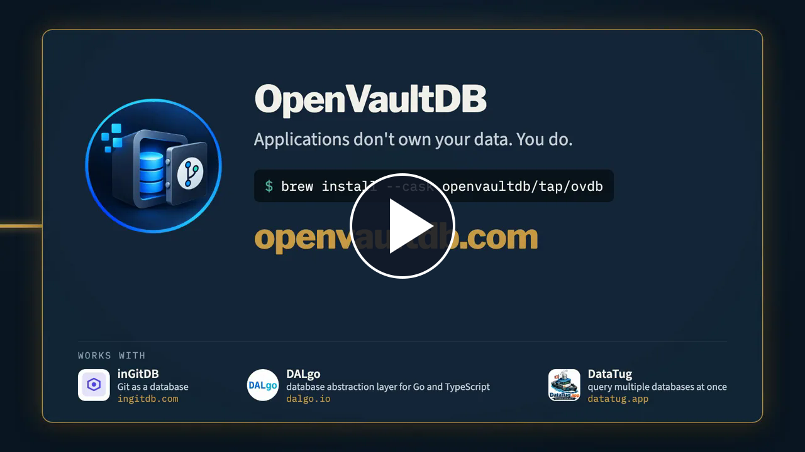

# setup-ovdb

[](https://youtu.be/LMTcLntUWJM)

[Watch the OpenVaultDB product video](https://youtu.be/LMTcLntUWJM)

Install an exact [OpenVaultDB CLI](https://github.com/openvaultdb/ovdb) release in GitHub Actions without Go. This action installs the CLI only; workflows choose which commands to run.

`version` is required and must be an exact release tag. `expected-sha256` optionally supplies an independently obtained digest for the selected platform archive. The release checksum file detects corruption but cannot authenticate a release if both archive and checksum are replaced. The `version` output contains the installed release tag.

Linux and macOS support amd64 and arm64; Windows supports amd64 where the release contains those assets.

```yaml
- uses: actions/checkout@3d3c42e5aac5ba805825da76410c181273ba90b1 # v7.0.1
- uses: openvaultdb/setup-ovdb@040213997fe16b0d199bbe5a2f2b95bfb6abdce0
  with:
    version: v0.43.3
- run: ovdb --version
```
